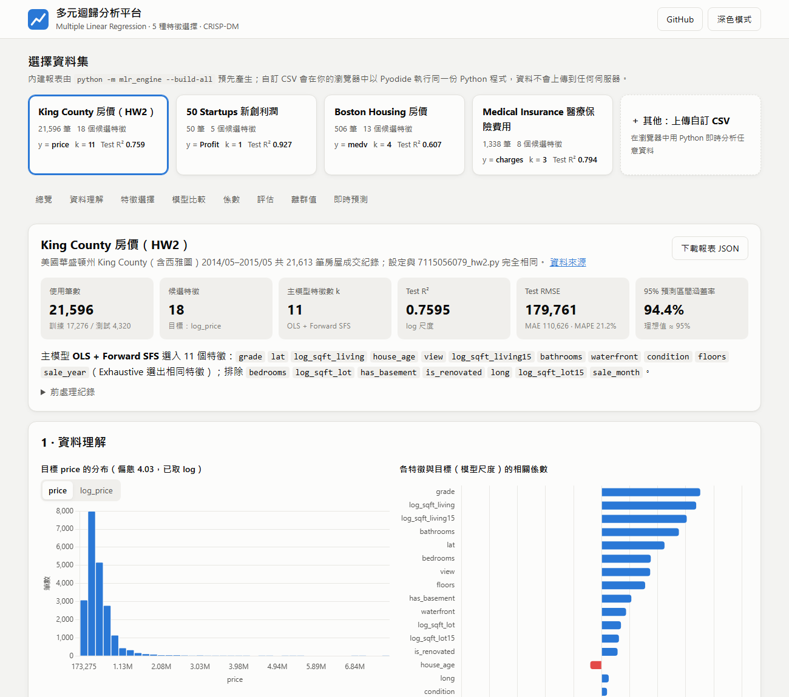

# AIoT HW2：模組化多元線性迴歸分析平台

> 🌐 **線上展示**：<https://yui000130.github.io/AIoT-HW2/>
> 📦 **GitHub**：<https://github.com/yui000130/AIoT-HW2>

把 HW2（King County 房價預測）的完整分析流程拆成可重複使用的 Python 套件 **`mlr_engine`**，
任何 CSV 都能套用同一套「前處理 → 五種特徵選擇 → 依 k 比較 → 簡約選模 → 統計檢定與診斷 → 部署預測」流程，
結果以網頁儀表板呈現。

<p align="center"></p>

同一份 Python 程式碼有兩種執行方式：

| 執行方式 | 用途 |
|---|---|
| **本機 CLI**：`python -m mlr_engine` | 產生內建資料集的報表 JSON（`reports/`），網頁直接讀取 |
| **瀏覽器 Pyodide**：`assets/js/worker.js` | 網頁上傳任意 CSV，在使用者瀏覽器中執行 `mlr_engine`，資料不會上傳到伺服器 |

---

## 內建資料集

| 資料集 | 筆數 | 目標 y | 主模型 | Test R² |
|---|---:|---|---|---:|
| **King County 房價（HW2）** | 21,596 | `price`（取 log） | OLS + Forward SFS，k = 11 | 0.7595 |
| 50 Startups 新創利潤 | 50 | `Profit` | OLS + Lasso，k = 1（R&D Spend） | 0.9265 |
| Boston Housing 房價 | 506 | `medv` | OLS + Lasso，k = 4 | 0.6071 |
| Medical Insurance 醫療費用 | 1,338 | `charges`（取 log） | OLS + Lasso，k = 3 | 0.7941 |

`configs/kc_house.json` 與 `7115056079_hw2/7115056079_hw2.py` 的設定完全相同。模組化後的結果與原始作業一致（單元測試會檢查）：
k = 11、Test R² = 0.760、整體 F = 5,317、最大 VIF = 4.14、Durbin-Watson = 2.02、95% 預測區間涵蓋率 = 94.4%、最大 Cook's D = 0.014。

---

## 分析流程（CRISP-DM）

1. **Data Understanding**：欄位型態自動判斷（數值 / 類別 / 日期 / ID / 常數 / 長文字）、目標分布、相關係數與相關矩陣。
2. **Data Preparation**：數字字串清洗（`$`、`,`、`%`）、日期展開為年月、異常值過濾、衍生欄位、log 轉換、
   類別欄位以「最常見類別」為基準組建立虛擬變數、缺失值補中位數 / 眾數、目標右偏時自動取 log。
3. **Modeling**：自製 `OLS` 類別（係數、標準誤、t、p-value、CI、PI、F 檢定、AIC / BIC），以及五種特徵選擇：

   | 方法 | 做法 |
   |---|---|
   | Lasso (L1) | 依正則化路徑上係數「離開 0」的先後排序 |
   | Forward SFS | 每次加入讓 k-fold CV R² 提升最多的特徵 |
   | RFE | 反覆刪除標準化係數絕對值最小的特徵 |
   | ElasticNet | 同 Lasso，l1_ratio = 0.5，共線性高時較穩定 |
   | Exhaustive | 以 Gram 矩陣窮舉 2ᵖ − 1 種子集，找每個 k 的最佳組合 |

4. **Evaluation**：每個方法、每個 k 的 CV RMSE / Test RMSE / Test R²；以簡約規則選 k
   （`one_se`：1-SE 法則；`tolerance`：CV RMSE ≤ 最小值 + 容忍值），取特徵數最少者為主模型；
   殘差診斷（Durbin-Watson、Jarque-Bera、Q-Q 圖）、VIF、槓桿值 / 學生化殘差 / Cook's distance、移除高影響點的穩健性檢查，以及梯度提升樹參考模型。
5. **Deployment**：報表中包含 β、(XᵀX)⁻¹、σ²，網頁的「即時預測」直接計算點估計與 95% 預測區間。

---

## 專案結構

```
AIoT-HW2/
├── index.html                 # 儀表板網頁（GitHub Pages 入口）
├── assets/
│   ├── css/style.css          # 版面與淺色 / 深色主題
│   ├── js/app.js              # 讀報表、畫圖（Chart.js）、即時預測、上傳流程
│   ├── js/worker.js           # Web Worker：載入 Pyodide 並執行 mlr_engine
│   └── preview.png
├── mlr_engine/                # 分析引擎（純 numpy / pandas / scipy / scikit-learn）
│   ├── io.py                  # 讀任意 CSV：編碼、分隔符號、無標題列
│   ├── prep.py                # 欄位判斷與前處理
│   ├── ols.py                 # OLS 與 VIF
│   ├── selection.py           # 五種特徵選擇演算法
│   ├── pipeline.py            # 完整流程，輸出報表 dict
│   ├── web_api.py             # 給瀏覽器呼叫的 JSON 介面
│   └── __main__.py            # 命令列介面
├── configs/*.json             # 每個內建資料集的設定
├── data/*.csv                 # 內建資料集
├── reports/*.json             # 預先產生的報表（index.json 為清單）
├── tests/test_engine.py       # 單元測試（含 HW2 結果重現）
└── 7115056079_hw2/            # 原始作業（.py / .ipynb / 報告 PDF）
```

---

## 使用方式

### 1. 網頁

```bash
git clone https://github.com/yui000130/AIoT-HW2.git
cd AIoT-HW2
python -m http.server 8000
# 開啟 http://localhost:8000/
```

> 需要透過 HTTP 伺服器開啟（Web Worker 與 fetch 無法在 `file://` 下運作）。

選擇內建資料集即可看報表；點「其他：上傳自訂 CSV」可拖曳檔案或貼上公開 CSV 網址，
確認欄位與目標後按「開始分析」。第一次使用會下載 Pyodide 與科學計算套件（約 30 MB，之後由瀏覽器快取）。

### 2. 命令列

```bash
pip install -r requirements.txt

# 分析任意 CSV（目標欄位省略則自動猜測）
python -m mlr_engine data/insurance.csv --target charges --out reports/my.json

# 依設定檔分析
python -m mlr_engine --config configs/kc_house.json

# 重新產生所有內建報表與 reports/index.json
python -m mlr_engine --build-all
```

### 3. Python

```python
from mlr_engine import read_csv_any, run_analysis

df = read_csv_any("data/50_Startups.csv")
report = run_analysis(df, target="Profit", model={"k_rule": "one_se"})
print(report["main"]["features"])     # ['R&D Spend']
```

---

## 新增一個內建資料集

1. 把 CSV 放進 `data/`。
2. 在 `configs/` 新增設定檔（只有 `id`、`data`、`target` 是必填）：

```json
{
  "id": "my_data",
  "title": "我的資料集",
  "description": "顯示在網頁上的說明",
  "data": "data/my_data.csv",
  "target": "y",
  "prep": {
    "log_target": "auto",
    "filters": ["x1 > 0"],
    "derive": {"age": "2025 - year_built"},
    "log_features": ["area"],
    "drop": ["id"],
    "categorical": ["zipcode"]
  },
  "model": {"k_rule": "one_se", "test_size": 0.2, "cv_folds": 5, "max_exhaustive": 18}
}
```

3. 執行 `python -m mlr_engine --build-all`，網頁就會出現新的資料集卡片。

| `prep` 參數 | 說明 |
|---|---|
| `log_target` | `true` / `false` / `"auto"`（全為正值且偏態 > 1 時取 log） |
| `date_features` | `"auto"` 或 `{"date": {"year": "sale_year", "month": "sale_month"}}` |
| `filters` | pandas `eval` 運算式清單，保留符合條件的列 |
| `derive` | 衍生欄位 `{新欄位: 運算式}`，布林結果轉成 0 / 1 |
| `log_features` | 取 log 的欄位，改名為 `log_<欄位>`（含 0 時改用 log1p） |
| `drop` / `features` | 刪除欄位 / 直接指定特徵清單與順序 |
| `categorical` | 強制當成類別處理的欄位（例如郵遞區號） |

| `model` 參數 | 預設 | 說明 |
|---|---|---|
| `k_rule` | `one_se` | `one_se` 或 `tolerance` |
| `k_tolerance` | 0.002 | `tolerance` 規則的容忍值 |
| `test_size` / `cv_folds` / `random_state` | 0.2 / 5 / 42 | 切分與交叉驗證 |
| `max_exhaustive` | 18 | 特徵數超過此值就略過 Exhaustive |
| `simple_feature` | 自動 | 單純線性回歸使用的特徵 |
| `reference_model` | true | 是否加入梯度提升樹參考模型 |

---

## 開發與部署

```bash
python -m unittest discover -s tests -v
```

網站是純靜態檔案，GitHub Pages 設定為 **Settings → Pages → Deploy from a branch → `main` / `(root)`**，
推送到 `main` 後約 1 分鐘自動更新。修改 `mlr_engine/` 或 `configs/` 後記得先執行 `python -m mlr_engine --build-all` 再提交報表。
